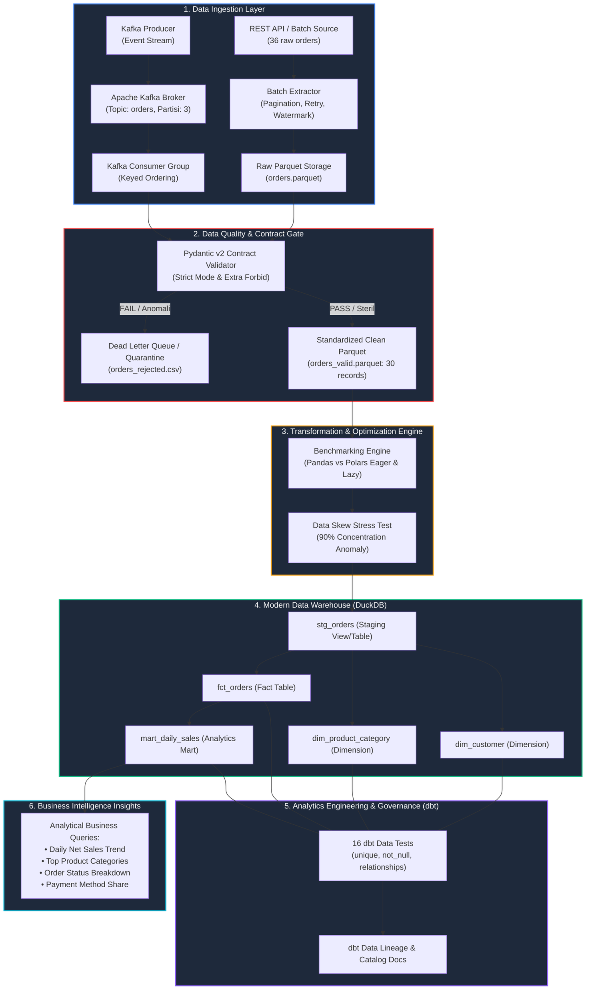

# End-to-End E-Commerce Event-to-Warehouse Pipeline 🛒⚡
### High-Performance Analytics Engineering Suite: Streaming, Data Contracts, Vectorized Transformation, & Dimensional Modeling

[](https://www.python.org/)
[](https://kafka.apache.org/)
[](https://docs.pydantic.dev/)
[](https://pola.rs/)
[](https://duckdb.org/)
[](https://www.getdbt.com/)
[](https://www.docker.com/)

---

## 📌 Ringkasan Proyek

Repositori ini memuat implementasi **Production-Ready Data & Analytics Engineering Pipeline** untuk analitika transaksi platform *e-commerce*. Pipeline dirancang untuk menyatukan dua paradigma data:
1. **Batch Historical Ingestion (REST API simulation):** Ekstraksi bertahap dengan *pagination*, *exponential backoff retry*, dan *watermarking* berbasis timestamp guna menjamin *idempotent ingestion* (bebas duplikasi saat proses berulang).
2. **Event-Driven Streaming (Apache Kafka):** Ingestion kejadian transaksi baru secara asinkron dengan *Keyed Partitioning* (`order_id`) untuk menjamin urutan status pesanan (FIFO) serta semantik pengiriman *at-least-once*.

Seluruh data melewati gerbang kualitas ketat (**Zero-Trust Data Contract Gate** berbasis Pydantic v2) sebelum diproses menggunakan engine berperforma tinggi (**Polars**) dan dimodelkan ke dalam **Star Schema** di **DuckDB Data Warehouse** yang diverifikasi otomatis dengan **16 data tests dbt**.

---

## 🏗️ Arsitektur Pipeline (End-to-End Topology)



---

## 🛠️ Keputusan Arsitektur & Teknologi (Tech Stack Rationale)

| Komponen | Teknologi | Alasan Pemilihan & Arsitektur |
|---|---|---|
| **Streaming Broker** | **Apache Kafka (Docker Compose)** | Standar industri untuk *event streaming* terdistribusi. Menjamin *ordering per entity* via *Keyed Partitioning* (`order_id`) dan *decoupling* antara producer dan consumer. |
| **Data Contract** | **Pydantic v2** | Menegakkan paradigma *Data Quality as Code* pada batas ingestion. Menolak *type coercion* diam-diam (`strict=True`) dan *schema drift* (`extra="forbid"`). |
| **Storage Format** | **Apache Parquet** | Format biner kolumnar dengan kompresi Snappy bawaan. Jauh lebih hemat I/O disk dan mempertahankan metadata tipe data dibanding CSV. |
| **Transformation** | **Polars (Rust Engine)** | Engine kolumnar multithreaded berbasis memori Apache Arrow. Menyediakan *Lazy Evaluation* (*predicate & projection pushdown*) yang mengungguli Pandas single-threaded. |
| **Data Warehouse** | **DuckDB** | Database analitik OLAP modern (*vectorized execution engine*) tanpa overhead server eksternal, ideal untuk pipeline modern berbasis file. |
| **Data Modeling** | **dbt (dbt-duckdb)** | Menstandarisasi transformasi data berbasis SQL, kontrol versi lineage, dan pengujian otomatis skema integritas relasional (*DataOps*). |

---

## 🛡️ Spesifikasi Data Contract & Audit Trail Karantina

Model kontrak data (`scripts/validate.py`) menerapkan aturan validasi ketat:

| Atribut | Tipe Data | Constraint & Validation Rule |
|---|---|---|
| `order_id` | `String` | Wajib diisi, `min_length=1` (Primary Key). |
| `customer_id` | `String` | Wajib diisi, tidak boleh berupa string kosong. |
| `order_ts` | `DateTime` | Format ISO-8601 timestamp valid. |
| `product_category` | `String` | Wajib terisi. |
| `quantity` | `Integer` | Wajib bilangan bulat positif (`gt=0`). |
| `unit_price` | `Float` | Nominal harga non-negatif (`ge=0`). |
| `discount_pct` | `Float` | Rasio diskon berada pada rentang valid `0.0 <= discount_pct <= 1.0`. |
| `status` | `Literal` | Nilai status dibatasi hanya: `paid`, `shipped`, `cancelled`, atau `refunded`. |

### Hasil Audit Dataset (`data/orders.csv` — 36 Record):
- **Lolos Validasi:** **30 record** disimpan ke `data/valid/orders_valid.parquet`.
- **Ditolak (Karantina DLQ):** **6 record cacat** diisolasi ke `data/rejected/orders_rejected.csv`:
  1. `O1031`: `quantity` bernilai `0` (melanggar `gt=0`).
  2. `O1032`: `unit_price` bernilai `-12.0` (nominal negatif tidak sah).
  3. `O1033`: `discount_pct` bernilai `1.2` (diskon > 100% melanggar range).
  4. `O1034`: `order_ts` bernilai `'not-a-date'` (timestamp rusak).
  5. `O1035`: `status` bernilai `'pending'` (status di luar skema resmi).
  6. `O1036`: `customer_id` bernilai string kosong `""`.

---

## ⚡ Hasil Benchmark Performa & Uji Data Skew

Pengujian transformasi finansial (`gross_amount` dan `net_amount`) dilakukan pada dataset berskala **100.000 baris**:

### 1. Benchmark Kecepatan Transformasi (100k Baris Parquet)
| Engine / Mode | Waktu Eksekusi | Speedup vs Pandas | Karakteristik Eksekusi |
|---|:---:|:---:|---|
| **Pandas (Eager)** | **62.59 ms** | 1.00x | Single-threaded, alokasi memori penuh, overhead intermediate object. |
| **Polars (Eager)** | **11.61 ms** | **5.39x Lebih Cepat** | Multithreaded Rust engine, alokasi kolom Apache Arrow. |
| **Polars (Lazy Execution)** | **6.47 ms** | **9.68x Lebih Cepat** | *Projection Pushdown* (hanya baca 5 kolom relevan) & *Predicate Pushdown*. |

### 2. Eksperimen Data Skew
- **Skenario:** Menguji beban agregasi `group_by('customer_id')` antara distribusi transaksi seimbang (100 customer merata) vs distribusi anomali *skew* (90% transaksi terkonsentrasi pada customer `C001`).
- **Hasil:** Waktu eksekusi meningkat dari **1.42 ms** (uniform) menjadi **2.75 ms** (skewed, 1.94x lebih lambat akibat beban berlebih pada satu bucket memori).
- **Mitigasi Teknis di Sistem Terdistribusi:** Menerapkan *salting key* (menambahkan salt acak pada key yang padat), agregasi dua tahap (*partial aggregation*), serta seleksi proyeksi kolom minimal untuk mencegah timbulnya *straggler node* atau kegagalan *Out-Of-Memory (OOM)*.

---

## 🏛️ Pemodelan Dimensional & Pengujian dbt (Star Schema)

Warehouse DuckDB dirancang menggunakan arsitektur **Star Schema**:
- **Staging View:** `stg_orders` — Standarisasi nama dan tipe data dari Parquet.
- **Tabel Dimensi:**
  - `dim_customer`: Unique identifier `customer_id`, customer tier.
  - `dim_product_category`: Unique identifier `product_category`, departemen kategori.
- **Tabel Fakta:** `fct_orders` — Transaksi granular, foreign keys, serta metrik keuangan (`net_sales`).
- **Tabel Data Mart:** `mart_daily_sales` — Agregasi penjualan menurut tanggal, kategori, dan metode pembayaran.

### Verifikasi 16 Pengujian Otomatis (`dbt test`):
```text
Running with dbt=1.12.6, duckdb=1.11.0
Found 5 models, 16 data tests

[PASS] unique_fct_orders_order_id ........................... (0.03s)
[PASS] not_null_fct_orders_order_id ......................... (0.03s)
[PASS] not_null_fct_orders_customer_id ...................... (0.03s)
[PASS] relationships_fct_orders_customer_id (FK Integrity) .. (0.04s)
[PASS] relationships_fct_orders_product_category ............ (0.04s)
... (11 tests lainnya pada dim_customer, dim_product_category, mart_daily_sales)

Completed successfully: PASS=16 WARN=0 ERROR=0 TOTAL=16 (100% Lolos)
```

---

## 📊 Hasil Analitika Bisnis (SQL Insights)

Hasil query analitik langsung pada `mart_daily_sales` dan `fct_orders`:

### 1. Tren Penjualan Bersih Harian (Top 5 Hari Tertinggi)
| Tanggal Order | Penjualan Bersih (Net Sales) | Jumlah Transaksi |
|:---:|:---:|:---:|
| **2026-09-06** | **$1,022.60** | 3 |
| 2026-09-03 | $584.05 | 3 |
| 2026-09-10 | $565.30 | 3 |
| 2026-09-01 | $363.57 | 3 |
| 2026-09-08 | $285.48 | 3 |

### 2. Kategori Produk Berdasarkan Penjualan
1. **Electronics:** **$2,079.17** (Kontributor omzet terbesar)
2. **Home:** $996.98
3. **Fashion:** $635.60
4. **Books:** $236.73

### 3. Distribusi Status Transaksi
- **Paid:** 20 pesanan ($2,443.85)
- **Shipped:** 8 pesanan ($968.18)
- **Refunded:** 1 pesanan ($474.05)
- **Cancelled:** 1 pesanan ($62.40)

### 4. Frekuensi Metode Pembayaran
1. **Credit/Debit Card:** 14 transaksi ($2,439.40)
2. **Bank Transfer:** 8 transaksi ($1,048.70)
3. **E-Wallet:** 8 transaksi ($460.37)

---

## 🚀 Panduan Menjalankan Proyek (Quickstart)

### Prasyarat
- Python 3.10 – 3.12
- Docker & Docker Compose (opsional, jika ingin menguji Kafka broker)

### 1. Clone & Setup Environment
```bash
git clone https://github.com/Bejochan/data-processing-miniproject.git
cd data-processing-miniproject
python -m venv .venv
source .venv/bin/activate  # atau .venv\Scripts\Activate.ps1 pada Windows
pip install -r requirements.txt
```

### 2. Jalankan Seluruh Pipeline dengan Satu Perintah
Skrip master runner akan mengeksekusi seluruh 5 tahapan pipeline secara berurutan:
```bash
python run_pipeline.py
```

### 3. Menjalankan Komponen Individual (Opsional)
```bash
# A. Ekstraksi Batch & Watermarking
python scripts/batch_ingest.py --source data/orders.csv --out data/raw

# B. Validasi Data Contract Pydantic v2
python scripts/validate.py --source data/orders.csv --valid-out data/valid --rejected-out data/rejected

# C. Benchmark Transformasi & Data Skew
python scripts/benchmark.py

# D. Build DuckDB Warehouse & Queries Analitik
python scripts/build_warehouse.py

# E. Menjalankan dbt Test & Generate Docs
cd dbt_project
dbt test --profiles-dir .
dbt docs generate --profiles-dir .
```

### 4. Menjalankan Streaming Event Kafka
```bash
docker compose up -d
python scripts/consumer.py  # Terminal 1 (Consumer)
python scripts/producer.py  # Terminal 2 (Producer)
```

---

## 📁 Struktur Repositori

```text
├── data/
│   ├── orders.csv                    # Dataset sumber (36 transaksi)
│   ├── watermark.json                # Watermark checkpoint metadata
│   ├── raw/orders.parquet            # Parquet hasil ekstraksi batch
│   ├── valid/orders_valid.parquet    # Data steril lolos kontrak (30 baris)
│   ├── rejected/orders_rejected.csv  # Log audit data ditolak (6 baris)
│   └── benchmark_results.json        # Hasil pengukuran waktu benchmark
├── scripts/
│   ├── batch_ingest.py               # Pagination, retry backoff, watermarking
│   ├── validate.py                   # Data contract Pydantic v2 & fail-fast
│   ├── benchmark.py                  # Benchmark Pandas vs Polars & data skew
│   ├── build_warehouse.py            # DuckDB Star Schema & SQL analytics
│   ├── producer.py                   # Kafka event publisher (20 events)
│   └── consumer.py                   # Kafka consumer & stream validation
├── warehouse/
│   └── warehouse.duckdb              # Database OLAP analitik DuckDB
├── dbt_project/                      # Proyek Analytics Engineering dbt
│   ├── dbt_project.yml
│   ├── profiles.yml
│   └── models/
│       ├── staging/stg_orders.sql
│       └── marts/
│           ├── dim_customer.sql
│           ├── dim_product_category.sql
│           ├── fct_orders.sql
│           ├── mart_daily_sales.sql
│           └── schema.yml            # 16 spesifikasi data tests dbt
├── docker-compose.yml                # Konfigurasi Apache Kafka Single Broker
├── run_pipeline.py                   # Master runner satu perintah
├── requirements.txt                  # Dependensi Python reproducible
└── README.md
```

---

## 👤 Author
- **Author:** Adnan Oktar
- **GitHub:** [@Bejochan](https://github.com/Bejochan)
- **Role:** Data & Analytics Engineer
