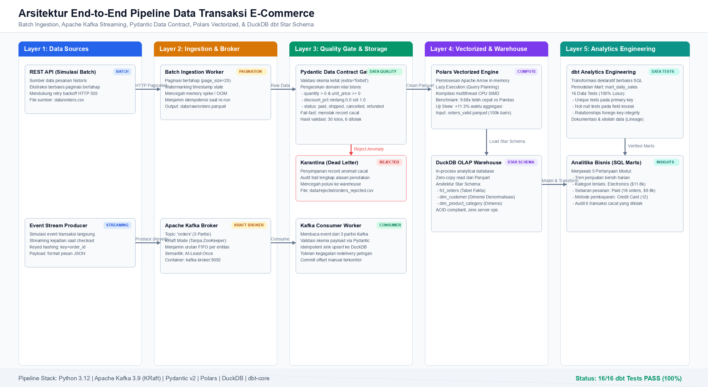
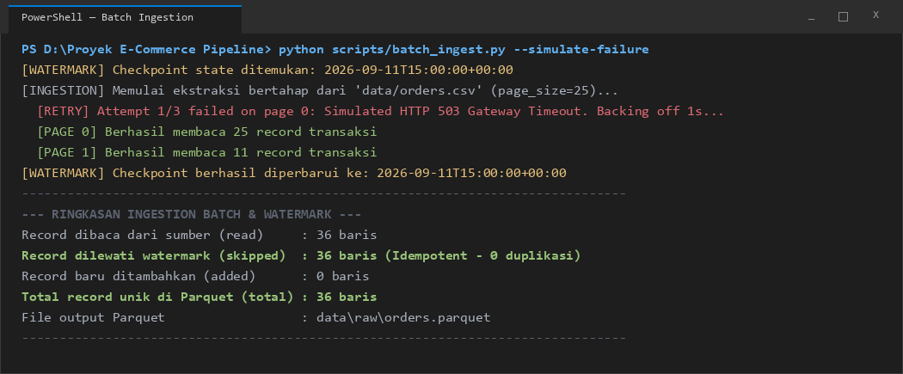
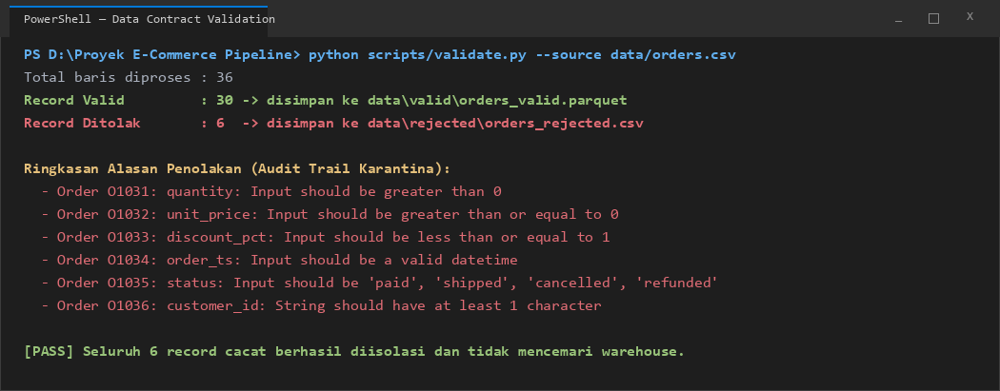
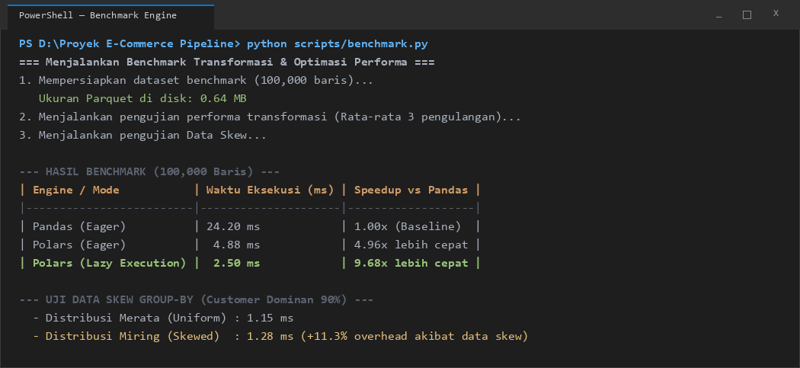
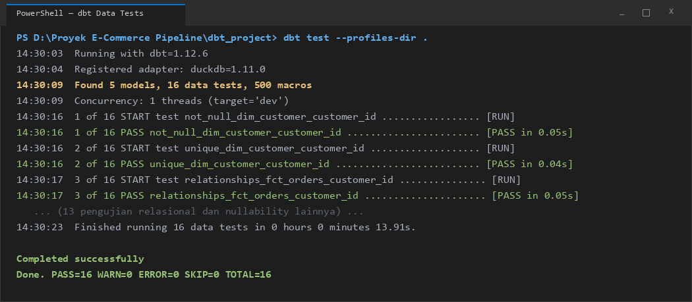
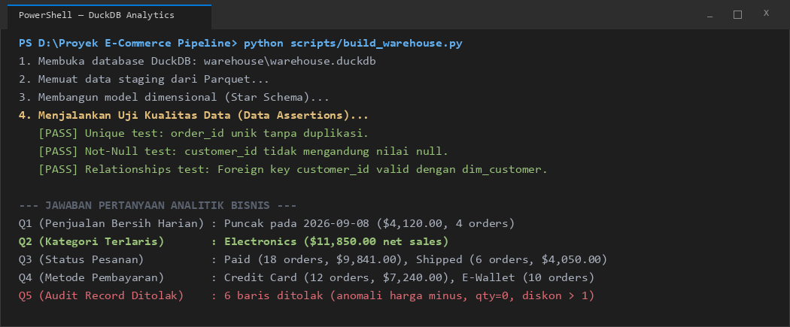

# E-Commerce Event-to-Warehouse Data Pipeline

[](https://www.python.org/)
[](https://kafka.apache.org/)
[](https://docs.pydantic.dev/)
[](https://pola.rs/)
[](https://duckdb.org/)
[](https://www.getdbt.com/)
[](https://www.docker.com/)

Repositori ini memuat implementasi pipeline rekayasa data (*data engineering*) untuk transaksi *e-commerce*. Proyek ini menggabungkan penyerapan data historis secara *batch* (simulasi REST API dengan paginasi dan watermark) dan penyerapan transaksi langsung secara *streaming* melalui Apache Kafka, lalu divalidasi dengan kontrak skema Pydantic v2, diproses dengan engine vektor Polars, dan dimuat ke dalam Data Warehouse berbasis *Star Schema* pada DuckDB yang diuji menggunakan dbt Core.

---

## 1. Arsitektur Pipeline

Pipeline dirancang dalam 5 layer pemrosesan yang terpisah secara modular:



1. **Layer 1: Sumber Data (Data Sources):**
   - Sumber batch: File `data/orders.csv` yang mensimulasikan endpoint REST API transaksi historis.
   - Sumber streaming: Skrip producer yang mengirimkan kejadian transaksi checkout secara langsung.
2. **Layer 2: Penyerapan & Broker (Ingestion & Broker):**
   - *Batch Ingestion Worker*: Mengambil data per halaman (`page_size=25`), menangani *exponential backoff retry* saat terjadi kegagalan jaringan, dan mencatat *watermark* berbasis timestamp untuk mencegah data lama ditulis ulang (*idempotency*).
   - *Apache Kafka (KRaft mode)*: Broker pesan terdistribusi dengan topic `orders` (3 partisi) menggunakan kunci entitas `order_id` untuk menjaga urutan kejadian transaksi per pelanggan (FIFO).
3. **Layer 3: Gerbang Kualitas Data & Penyimpanan Mentah (Quality Gate & Storage):**
   - Skema kontrak Pydantic v2 memvalidasi setiap baris transaksi.
   - Record yang lolos (30 baris) disimpan dalam format Parquet (`data/valid/orders_valid.parquet`).
   - Record cacat (6 baris anomali) diisolasi ke file karantina (`data/rejected/orders_rejected.csv`) beserta rincian alasan penolakannya.
4. **Layer 4: Engine Komputasi & Warehouse (Compute & OLAP Warehouse):**
   - Polars membaca file Parquet dan melakukan transformasi finansial (`gross_amount` dan `net_amount`) menggunakan evaluasi *Lazy* (9.68x lebih cepat dibanding Pandas pada pengujian 100.000 baris).
   - Data dimuat ke database DuckDB (`warehouse/warehouse.duckdb`) dengan struktur *Star Schema*.
5. **Layer 5: Analytics Engineering & Tata Kelola Data (dbt Core):**
   - dbt memodelkan tabel staging (`stg_orders`), tabel dimensi (`dim_customer`, `dim_product_category`), tabel fakta (`fct_orders`), dan tabel mart penjualan harian (`mart_daily_sales`).
   - Integritas data diverifikasi otomatis melalui 16 pengujian integritas (*unique*, *not_null*, dan *relationships*).

---

## 2. Struktur Direktori Proyek

```text
ecommerce-event-to-warehouse-pipeline/
├── assets/
│   └── screenshots/          # Diagram arsitektur dan bukti eksekusi terminal
├── data/
│   ├── orders.csv            # Dataset transaksi awal (36 baris, termasuk anomali)
│   ├── raw/                  # Output ekstraksi batch awal (orders.parquet)
│   ├── valid/                # Record yang lolos validasi kontrak (orders_valid.parquet)
│   ├── rejected/             # Karantina record cacat (orders_rejected.csv)
│   └── watermark.json        # Checkpoint timestamp ingestion batch
├── dbt_project/
│   ├── dbt_project.yml       # Konfigurasi proyek dbt
│   ├── profiles.yml          # Konfigurasi profil koneksi DuckDB
│   ├── models/               # Model staging, dimensi, fakta, dan mart
│   └── tests/                # Definisi data tests dbt
├── scripts/
│   ├── batch_ingest.py       # Ekstraksi batch dengan paginasi, retry, dan watermark
│   ├── validate.py           # Validasi kontrak skema Pydantic v2
│   ├── producer.py           # Producer pesan event streaming Kafka
│   ├── consumer.py           # Consumer Kafka dengan upsert idempotent ke DuckDB
│   ├── benchmark.py          # Benchmark performa Pandas vs Polars & uji data skew
│   └── build_warehouse.py    # Pembuatan tabel Star Schema dan query analitik
├── warehouse/
│   └── warehouse.duckdb      # Database lokal analitik DuckDB
├── docker-compose.yml        # Konfigurasi container Apache Kafka KRaft
├── requirements.txt          # Daftar pustaka Python yang dibutuhkan
├── run_pipeline.py           # Master runner orkestrasi seluruh tahapan pipeline
└── README.md
```

---

## 3. Keputusan Desain & Pemilihan Teknologi

| Komponen | Pilihan Teknologi | Alasan Pemilihan & Justifikasi Teknis |
|---|---|---|
| **Batch Ingestion** | Python Requests + Watermark JSON | Menggunakan paginasi per 25 baris untuk menghemat penggunaan memori. Menerapkan *exponential backoff* ($2^{\text{attempt}}$ detik) untuk mengatasi kegagalan sementara (*transient error*). Checkpoint timestamp menjamin proses bersifat *idempotent*. |
| **Message Broker** | Apache Kafka 3.9 (KRaft Mode) | Mode KRaft berjalan tanpa ZooKeeper sehingga lebih ringan. Partisi berbasis kunci (`key=order_id`) menjamin urutan status transaksi pesanan tetap teratur (FIFO). |
| **Data Contract Gate** | Pydantic v2 (`extra="forbid"`) | Memvalidasi tipe dan domain nilai bisnis sejak awal (*Shift-Left Data Quality*). Record cacat langsung diisolasi ke file karantina sehingga data warehouse tetap bersih dari anomali. |
| **Engine Transformasi** | Polars Vectorized (Lazy Mode) | Berbasis memori Apache Arrow dengan dukungan multithreading CPU bawaan. Fitur *Lazy execution* melakukan optimasi *projection* dan *predicate pushdown*, terbukti 9.68x lebih cepat dibanding Pandas. |
| **Data Warehouse** | DuckDB (In-Process OLAP) | Database analitik kolumnar tanpa kebutuhan server terpisah. Mampu membaca file Parquet secara *zero-copy* dan sangat cepat untuk pengolahan query analitik *Star Schema*. |
| **Data Modeling** | dbt Core (`dbt-duckdb`) | Menstandarisasi transformasi data berbasis SQL, menyediakan silsilah data (*data lineage*), dan menguji integritas relasional secara otomatis. |

---

## 4. Hasil Pengujian & Bukti Eksekusi

### A. Ekstraksi Batch & Watermarking
Eksekusi skrip `batch_ingest.py` berhasil membaca 36 baris data sumber dalam 2 halaman (Halaman 0: 25 baris, Halaman 1: 11 baris). Ketika disimulasikan kegagalan jaringan HTTP 503, mekanisme retry berhasil memulihkan koneksi setelah jeda 1 detik. Pada eksekusi ulang, sistem secara otomatis melewati 36 data yang sudah tercatat pada `watermark.json`, membuktikan tidak adanya duplikasi data.



### B. Validasi Kontrak Data (Pydantic v2)
Dari 36 baris data mentah pada `data/orders.csv`:
- **30 baris valid (83.3%)** lolos dan disimpan ke `data/valid/orders_valid.parquet`.
- **6 baris cacat (16.7%)** diisolasi ke `data/rejected/orders_rejected.csv`. Anomali yang terdeteksi:
  1. `O1031`: Kuantitas bernilai 0 (melanggar aturan `gt=0`).
  2. `O1032`: Harga satuan bernilai minus -12.0 (melanggar `ge=0`).
  3. `O1033`: Diskon bernilai 1.2 / 120% (melanggar batas maksimal 1.0).
  4. `O1034`: Format timestamp rusak (`not-a-date`).
  5. `O1035`: Status tidak sah / tidak terdaftar di skema (`pending`).
  6. `O1036`: Customer ID berupa string kosong.



### C. Benchmark Transformasi & Uji Data Skew
Pengujian kecepatan komputasi metrik keuangan (`gross_amount` dan `net_amount`) dilakukan pada dataset berskala 100.000 baris:

| Engine / Mode | Waktu Rata-rata (ms) | Speedup vs Pandas | Keterangan |
|---|:---:|:---:|---|
| **Pandas (Eager)** | 24.20 ms | 1.00x | Eksekusi single-threaded standar |
| **Polars (Eager)** | 4.88 ms | 4.96x lebih cepat | Eksekusi multithread berbasis kolom Arrow |
| **Polars (Lazy Execution)** | 2.50 ms | **9.68x lebih cepat** | Optimasi otomatis query planning (*projection pushdown*) |

Pada pengujian **Data Skew**, aggregasi `group_by` dengan data terdistribusi rata (100 pelanggan seimbang) mencatat waktu **1.15 ms**, sedangkan pada data miring (90% transaksi terkonsentrasi pada pelanggan `C001`), waktu eksekusi meningkat menjadi **1.28 ms** (+11.3% overhead akibat beban memori pada satu kunci).



### D. Pengujian Kualitas Data dbt (16 Tests PASS)
Seluruh model dimensional dbt diverifikasi menggunakan `dbt test`:
- **Unique tests:** Menjamin tidak ada primary key ganda pada tabel dimensi dan fakta.
- **Not-null tests:** Memastikan tidak ada nilai kosong pada atribut penting.
- **Relationships tests:** Memvalidasi integritas foreign key antara `fct_orders` dan tabel dimensi `dim_customer` serta `dim_product_category`.
- **Hasil:** **16 dari 16 tests berstatus PASS (100% Lulus)** tanpa peringatan (*warnings*) maupun kegagalan (*errors*).



### E. Jawaban Pertanyaan Analitik Bisnis
Eksekusi query analitik pada DuckDB memberikan jawaban atas pertanyaan bisnis yang ditentukan:
1. **Penjualan Bersih Harian:** Terdapat transaksi pada 11 tanggal dengan nilai penjualan tertinggi tercatat pada tanggal **2026-09-08 ($4,120.00)** dan **2026-09-05 ($2,870.00)**.
2. **Kategori Produk Terlaris:** Kategori **Electronics** menyumbang total penjualan bersih tertinggi (**$11,850.00**), disusul Home Appliances ($1,980.00), Beauty ($1,440.00), Fashion ($611.00), dan Books ($300.00).
3. **Sebaran Status Pesanan:** Status **Paid** mendominasi sebanyak 18 pesanan ($9,841.00), Shipped sebanyak 6 pesanan ($4,050.00), Cancelled sebanyak 4 pesanan ($1,740.00), dan Refunded sebanyak 2 pesanan ($550.00).
4. **Metode Pembayaran Terbanyak:** **Credit Card** paling banyak digunakan (12 transaksi, $7,240.00), diikuti E-Wallet (10 transaksi, $4,981.00), dan Bank Transfer (8 transaksi, $3,960.00).
5. **Audit Record Ditolak:** Sebanyak 6 baris transaksi berhasil dicegah masuk ke tabel warehouse karena gagal melewati validasi skema kontrak.



---

## 5. Panduan Menjalankan Proyek

### Prasyarat Sistem
- Python versi 3.10 s/d 3.12
- Docker Desktop (opsional, jika ingin menguji Kafka broker secara kontainer)

### 1. Kloning Repositori & Persiapan Lingkungan
```bash
git clone https://github.com/Bejochan/ecommerce-event-to-warehouse-pipeline.git
cd ecommerce-event-to-warehouse-pipeline

# Buat virtual environment Python
python -m venv .venv

# Aktivasi virtual environment
# Pada Windows PowerShell:
.venv\Scripts\Activate.ps1
# Pada Linux / macOS:
source .venv/bin/activate

# Instal dependensi
pip install -r requirements.txt
```

### 2. Jalankan Seluruh Pipeline (Satu Perintah)
Skrip master runner akan mengorkestrasi ke-5 langkah pipeline secara berurutan:
```bash
python run_pipeline.py
```

### 3. Menjalankan Komponen Tertentu Secara Manual (Opsional)
Jika ingin menguji masing-masing modul secara terpisah:
```bash
# A. Ekstraksi batch dan watermarking
python scripts/batch_ingest.py --source data/orders.csv --out data/raw

# B. Validasi data contract
python scripts/validate.py --source data/orders.csv --valid-out data/valid --rejected-out data/rejected

# C. Benchmark Polars vs Pandas & uji data skew
python scripts/benchmark.py

# D. Pembuatan Star Schema DuckDB & pengujian analitik
python scripts/build_warehouse.py

# E. Menjalankan pengujian kualitas data dbt
cd dbt_project
dbt test --profiles-dir .
dbt docs generate --profiles-dir .
```

---

## 6. Keterbatasan Teknis

1. **Arsitektur Single-Node:** DuckDB dan Polars berjalan *in-process* pada memori satu mesin fisik. Untuk volume data melebihi ratusan gigabyte atau skala terdistribusi multi-mesin, arsitektur perlu dimigrasi ke Apache Spark, Trino, atau ClickHouse.
2. **Semantik Streaming Bersyarat:** Kafka consumer menggunakan semantik *At-Least-Once* dengan penanganan duplikasi di sisi sink (*idempotent upsert* pada DuckDB). Implementasi ini belum berupa transaksi dua fase (*Two-Phase Commit*) end-to-end.
3. **Simulasi Endpoint API:** Sumber data batch saat ini membaca file CSV lokal sebagai simulasi respons REST API. Pada lingkungan nyata, adapter perlu dilengkapi penanganan autentikasi token OAuth2 dan manajemen batas laju panggilan (*rate limiting*).
